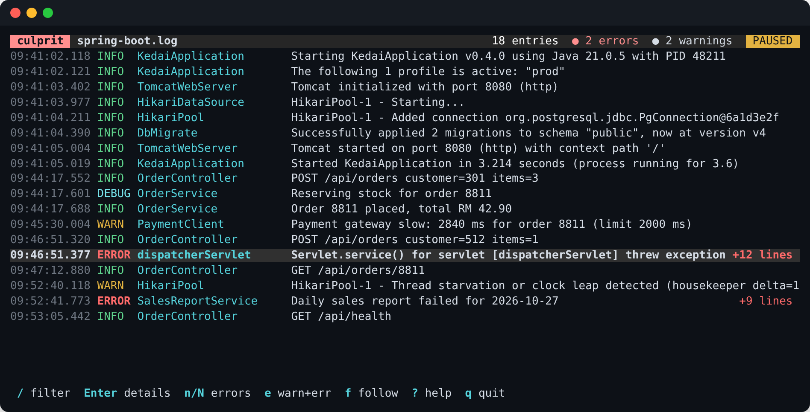
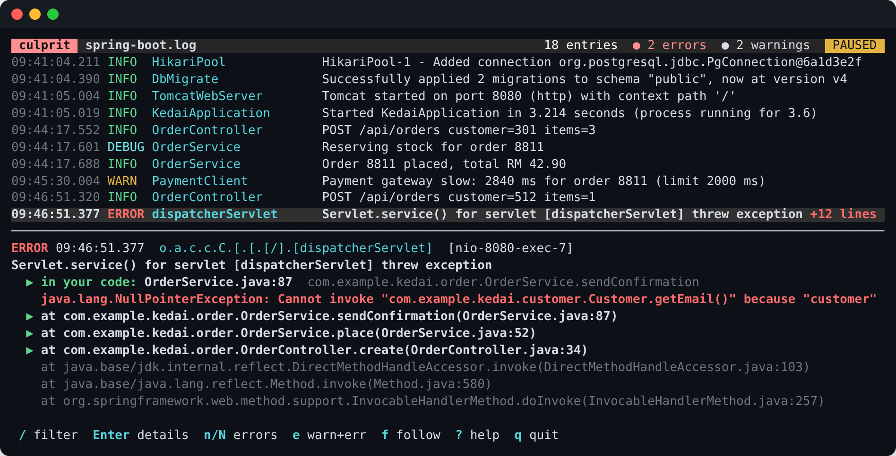
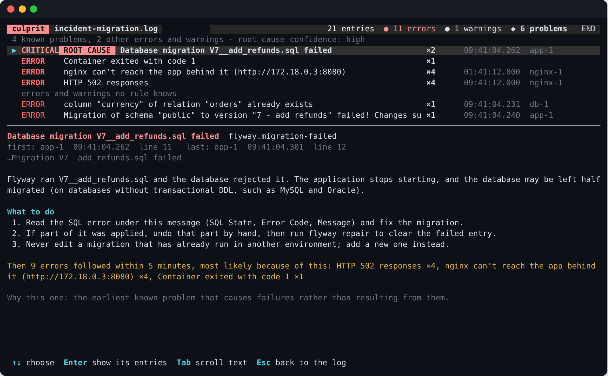
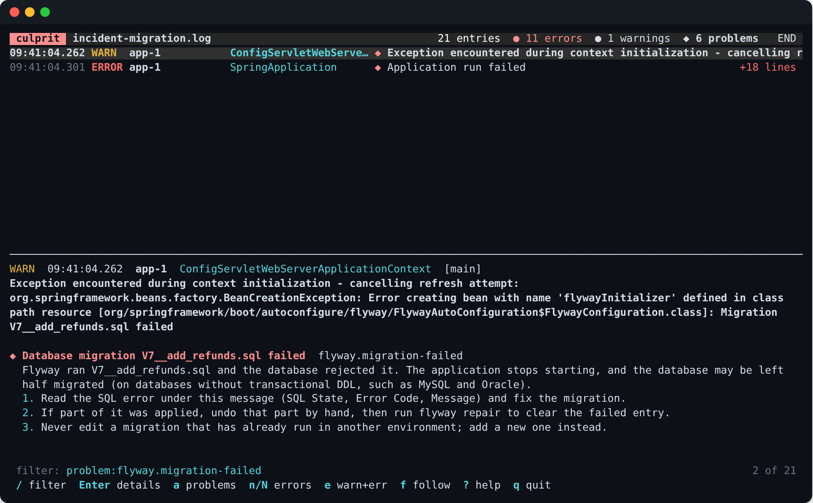
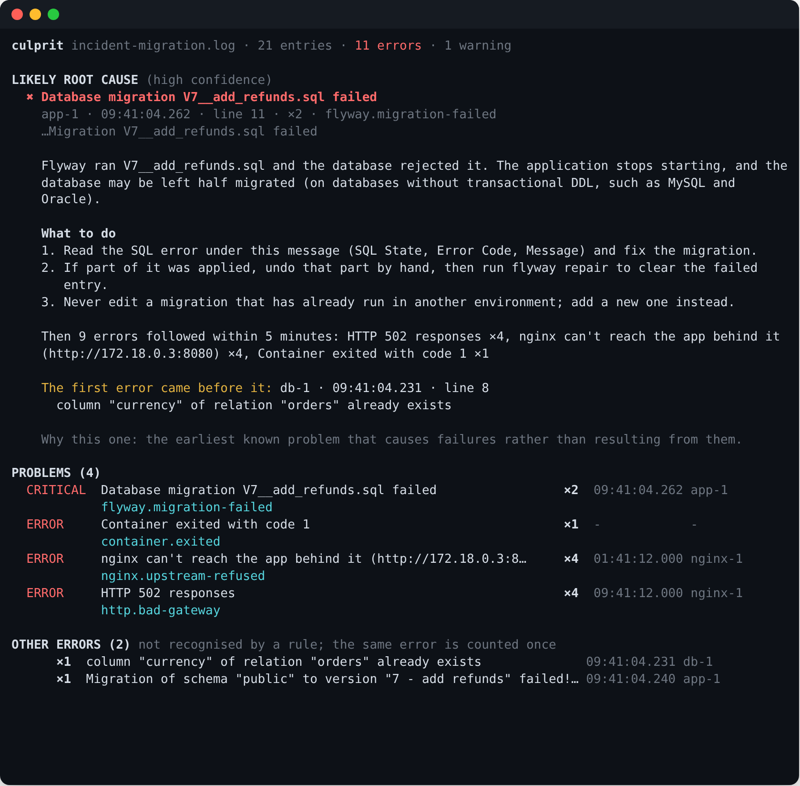
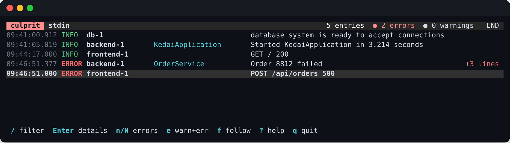
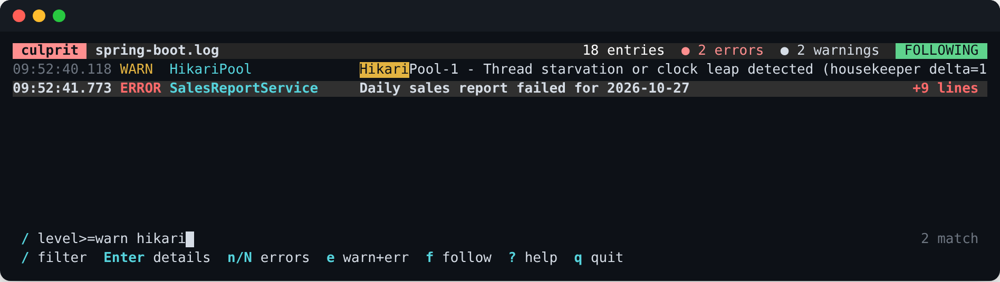

# culprit

[](https://github.com/amirizalrahmat0799/culprit/actions/workflows/ci.yml)
[](https://www.npmjs.com/package/culprit-cli)

[](LICENSE)

**Read your logs in the terminal, follow them live, and find out what went wrong, why, and where in your code.**

```bash
culprit app.log
docker compose logs -f | culprit
kubectl logs -f deploy/api | culprit
culprit analyze app.log        # print the likely root cause and what to do
culprit investigate app.log    # optional: ask an AI to find the cause in your code
```



Logs are written for machines: JSON on one long line, stack traces of 80 frames where three are yours, five
services interleaved. culprit turns them back into something you can read. One entry per line, coloured by
level, with stack traces folded into the entry they belong to. Open an error and it shows **where in your
code** it happened, with the framework frames dimmed.



## Finding the cause

When something breaks, the first error you notice is rarely the one to fix. A database migration fails, the
app doesn't start, nginx can't reach it, and the log fills with 502s. culprit reads all of it and tells you
which error started it.

Press `a` in the viewer for the problems it found:



- **It recognises known problems.** Over 110 rules cover Spring Boot, Hibernate, Flyway and Liquibase,
  HikariCP, the JVM, Oracle (ORA- errors), PostgreSQL, MySQL, Node, Python, Go, Docker, Kubernetes and nginx.
  Each says what the problem means and what to do, with the values from your log filled in: the port, the
  pool, the table, the migration.
- **It finds the likely root cause.** The earliest problem that *causes* failures, not the connection refused,
  timeouts and 502s that follow it, and how many errors came after it.
- **It groups the errors no rule knows.** The same error with a different order id or UUID is counted once, with
  its root exception (the last `Caused by:`) and the first line in your code.

`Enter` on a problem shows its entries in the log, with the explanation under each one. Entries with a problem
are marked `◆`, and `p` jumps to the next one.



### culprit analyze

The same analysis as a report, for when you don't need the viewer: in a terminal, a pull request, or CI.

```bash
culprit analyze app.log
docker compose logs --no-color | culprit analyze
kubectl logs deploy/api --previous | culprit analyze --format markdown
culprit analyze --format json app.log | jq '.root_cause'
```



In CI, `--fail-on error` makes the step fail when the logs contain an error, and the Markdown report fits in a
job summary or a pull request comment:

```yaml
- name: What went wrong
  if: failure()
  run: |
    npm install -g culprit-cli
    docker compose logs --no-color > compose.log
    culprit analyze --format markdown compose.log >> "$GITHUB_STEP_SUMMARY"
```

### Your own rules

Add rules for the problems your team keeps meeting in `.culprit/rules/*.toml`, next to your code:

```toml
[[rule]]
id = "kedai.payment-declined"
title = "Payment declined by the bank: {reason}"
severity = "warning"
contains = ["payment declined"]
regex = 'payment declined: (\w+)'
captures = ["reason"]
explain = "The bank refused the card ({reason}). Nothing failed in our code."
fix = ["Nothing to fix; the customer has to use another card."]
examples = ['2026-10-28 10:00:00.000  WARN 1 --- [main] c.e.k.PaymentClient : payment declined: insufficient_funds']
```

`culprit rules --check` makes sure each rule recognises its examples. A rule with the id of one of culprit's
replaces it, so you can point an explanation at your own runbook. See [Writing rules](docs/rules.md).

## Asking an AI (optional)

Rules explain known problems. For the rest, or to find *where in your code* it went wrong, culprit can hand
the error to an AI and let it read your project: the code at the stack trace, a search for where a value
comes from, the recent git changes to those files. It answers with the cause, the fix, and quotes from your
files, and culprit checks every quote against the real file (`✓` or `✗`) before showing it.

```bash
culprit ai setup                   # once: choose the AI
culprit investigate app.log        # investigate the likely root cause
```

In the viewer, select an error and press `i`.

You choose the AI, and nothing is used until you do:

- **A model on your computer with [Ollama](https://ollama.com)** (free, private; `qwen3:8b` runs on an 8 GB GPU)
- **A free cloud service:** Groq, OpenRouter, Cerebras, Google Gemini
- **Your own API key:** Anthropic (Claude), OpenAI, Mistral, DeepSeek
- **Your company's server:** any OpenAI-compatible URL
- **None**

The AI can only read, only inside the project, and never files that may hold secrets (`.env`, keys,
credentials, anything git ignores). Values like passwords are redacted in what it does read. Before anything
is sent to a provider that isn't on your computer, culprit asks. It can be switched off per run (`--no-ai`),
per machine (`CULPRIT_AI=off`), or for a whole project (`ai = false` in `.culprit/config.toml`).
See [Investigating with AI](docs/ai.md).

## What it does

- **Understands your logs without setup.** JSON from Spring Boot (ECS, Logstash, GELF), pino, zap, slog and
  python-json-logger; logfmt; Spring Boot's and logback's default patterns; Python logging and uvicorn; Go's
  `log`; nginx and Apache access logs (the HTTP status becomes the level); and the prefixes
  `docker compose logs` and `kubectl logs --prefix` add.
- **Keeps errors in one piece.** Java stack traces (with `Caused by:`), Python tracebacks and Go panics are
  attached to the line before them, so one error is one entry.
- **Points at your code.** The first frame that's yours, not Spring's, Express's or the JDK's, is shown at the
  top: `▶ in your code: OrderService.java:87`.
- **Follows live.** Files are followed like `tail -F`, including when log rotation replaces them. Piped input
  streams in as it arrives, and the keyboard still works.
- **Filters as you type.** Words, phrases, levels, fields and regular expressions, all at once.
- **Lines up services.** Several files or Compose services get a source column, and timestamps from different
  time zones are all shown in your local time.
- **Explains what went wrong.** Recognises over 110 known problems, finds the likely root cause, and groups
  repeated errors. See [Finding the cause](#finding-the-cause).
- **Copes with big logs.** A million lines (118 MB) open in a couple of seconds, and filtering them while you
  type stays instant.
- **Works in scripts too.** `--plain` prints formatted entries instead of opening the viewer. It's automatic
  when the output isn't a terminal, so `culprit --filter has:stack app.log > errors.txt` works in CI.



## Install

**npm** ([culprit-cli](https://www.npmjs.com/package/culprit-cli), for Windows, macOS, and Linux x64 and arm64):

```bash
npm install -g culprit-cli
# or try it without installing
npx culprit-cli app.log
```

npm installs only the prebuilt binary for your machine. culprit itself doesn't need Node; Node just starts it.

**Homebrew** (macOS, Linux):

```bash
brew install amirizalrahmat0799/tap/culprit
```

**Download:** take the build for your system from [Releases](https://github.com/amirizalrahmat0799/culprit/releases)
and put `culprit` on your `PATH`.

To build it yourself you need a C++20 compiler and CMake 3.24 or newer. [FTXUI](https://github.com/ArthurSonzogni/FTXUI),
the terminal UI library, is downloaded during configure unless it's already installed.

```bash
cmake -S . -B build -DCMAKE_BUILD_TYPE=Release
cmake --build build --config Release
```

## Keys

| Keys | |
|---|---|
| `↑` `↓` / `j` `k`, `PgUp` `PgDn`, `g` `G`, mouse wheel | move |
| `Enter` | open or close the details of an entry; `Tab` scrolls them |
| `a` | the problems culprit found, and the likely root cause; `Enter` shows a problem's entries |
| `p` / `P` | next / previous entry with a problem (marked `◆`) |
| `i` | ask the AI to investigate the selected error (after `culprit ai setup`) |
| `n` / `N` | next / previous error |
| `w` / `W` | next / previous warning |
| `/` | filter (`Enter` keeps it, `Esc` cancels) |
| `e` | only warnings and errors, and back |
| `x` | clear the filter |
| `f` | follow new lines on or off (`G` jumps to the end and follows) |
| `?` | all the keys |
| `q` | quit |

## Filters



| Filter | Matches |
|---|---|
| `payment` | the word anywhere: message, logger, stack trace, fields (case doesn't matter) |
| `"order failed"` | a phrase |
| `-health` | entries *without* the word |
| `level>=warn` | warnings and worse; also `level=error`, `level<=info` |
| `logger=OrderService` | a part: `logger`, `thread`, `source`, `message`, or any field (`orderId=8812`) |
| `userId!=42` | the field doesn't contain it |
| `/time(d)? out/` | a regular expression |
| `has:stack` | entries with a stack trace |
| `has:problem` | entries a rule recognised |
| `problem:hikari` | entries recognised by a rule whose id starts with `hikari` |
| `group:3` | the unrecognised errors in group 3 (the Problems panel sets this for you) |

Terms are combined: `level>=warn payment -health` means warnings and errors about payments, without health checks.

## Options

```
culprit [options] [file...]
  -F, --filter <query>   start with a filter
  -n, --no-follow        read files to the end and stop watching them
  -p, --plain            print instead of opening the viewer
      --no-stack         with --plain: leave out stack traces
      --no-color         no colours (also when NO_COLOR is set)
      --rules <path>     more rules: a .toml file or a folder of them

culprit analyze [options] [file...]
      --format <f>       text, markdown or json
      --fail-on <s>      exit with 1 on a problem at least this severe: critical, error, warning (default: never)
  -F, --filter <query>   analyse only matching entries, e.g. "source=api"
      --top <n>          how many groups of unrecognised errors to list
      --rules <path>     more rules

culprit rules [--check] [id...]

culprit investigate [options] [file...]
      --line <n>         investigate the entry at this line (default: the likely root cause)
      --problem <id>     ... or the first entry of this problem
      --format <f>       text, markdown or json
      --yes              don't ask before sending to a provider that isn't on this computer
      --show-prompt      print what would be sent, and stop
      --project <dir>    the project to read (default: the git repository you're in)

culprit ai setup | status | on | off
```

## How it's built

```
src/core/      no terminal code; tested on its own
  parser       recognises each format, strips Compose/kubectl prefixes, joins stack traces
  json         a small JSON reader that flattens objects into dotted keys (log.level, error.stack_trace)
  time         ISO 8601, Python/Log4j, bare clocks, epoch numbers; zoned times shown in local time
  stack        splits Java, Python, Node and Go traces into frames and tells your code from libraries
  filter       the filter language
  reader       background threads that follow files and stdin, and hand over entries in batches
  model        entries, the filter, the visible rows and counts per level
  rules        rule files: loading, checking, and matching every rule in one pass over each entry
  toml         a small reader for the part of TOML rule files use
  analyzer     problems, groups of repeated errors, and the likely root cause, kept up to date as lines arrive
src/ai/        the investigator: providers (OpenAI-compatible and Anthropic), the read-only project tools and
               their safety checks, the step loop, and checking the evidence
src/tui/       the FTXUI viewer, the plain printer and the analyze report
rules/         culprit's own rules, compiled into the program
```

- **Parsing is hand-written, not regular expressions.** It's both faster and more forgiving of the many small
  variations real logs have.
- **Reading never blocks the screen.** Background threads parse, and the viewer takes finished entries in
  batches. Only the rows on screen are drawn, so the size of the log doesn't matter.
- **A new entry is held back for a moment,** because the next lines might be its stack trace.
- **Rules are matched in one pass.** The text every rule looks for goes into one
  [Aho-Corasick](https://en.wikipedia.org/wiki/Aho%E2%80%93Corasick_algorithm) automaton, so an entry is read
  once however many rules there are; a rule's regular expression only runs on the lines that contain its text.
- **The root cause is a judgement, and says so.** It's the earliest problem that causes failures rather than
  resulting from them, with high, medium or low confidence. Times are compared across services only when the log
  says which time zone it uses; otherwise the order the lines arrived in decides.
- **Every rule carries a real log line as an example,** and the tests check each rule recognises its own.
- **No HTTP library is bundled.** culprit uses the system's own: libcurl on Linux and macOS (loaded only when
  the AI is used) and WinHTTP on Windows, so it stays one small file and follows the system's proxy and
  certificate settings.
- **The AI's safety rules are enforced by culprit, not asked of the model.** Every path it requests is
  resolved and checked before anything is read, and its answer is checked against the files after.
- **Piped input and the keyboard both work:** culprit keeps a copy of the pipe and points stdin back at the
  terminal (`/dev/tty`, or `CONIN$` on Windows).

## Tests

```bash
ctest --test-dir build --output-on-failure
```

The sample logs in [`testdata/`](testdata) cover every supported format, plus an incident where a failed
migration takes down an app behind nginx, and [`testdata/kedai`](testdata/kedai) is the small project behind it.
The AI tests use a scripted model, and `tests/ai_e2e.sh` runs whole investigations over HTTP against a fake
provider in both API formats, checking that secrets and files outside the project are never sent. The tests check what each one parses into (levels, loggers, threads,
messages, fields, stack traces kept whole, the first frame in your code) and what the analysis finds. Every
built-in rule is checked against its examples. CI builds and tests on Windows, Linux and macOS.

## Roadmap

culprit is being built in three steps:

1. **The viewer** (0.1): reading, following, filtering, and pointing at your code.
2. **The analyser** (0.2): rules that recognise common problems and say what to do, groups of repeated
   errors, and the *first* failure behind a cascade of follow-on errors.
3. **The investigator** (0.3, this release): an AI of your choice (Ollama on your computer, a free cloud
   service, or your own API key) reads your project, read-only, and explains the root cause with evidence
   that culprit checks against your files.

## License

[MIT](LICENSE) © Ahmad Amirizal Rahmat
