# culprit

[](https://github.com/amirizalrahmat0799/culprit/actions/workflows/ci.yml)
[](https://www.npmjs.com/package/culprit-cli)

[](LICENSE)

**Read your logs in the terminal, follow them live, and find out what went wrong, why, and where in your code.**

```bash
culprit app.log
docker compose logs -f | culprit
kubectl logs -f deploy/api | culprit
culprit analyze app.log        # print the likely root cause and what to do
culprit investigate app.log    # optional: ask an AI to find the cause in your code
culprit web app.log            # the same in your browser
```

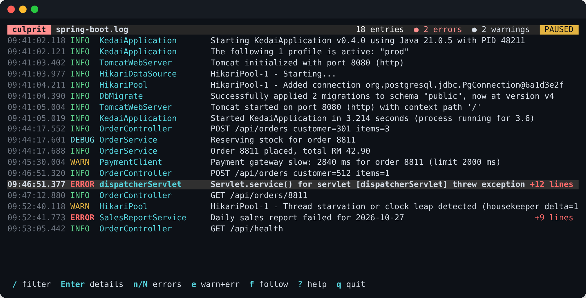

Logs are written for machines: JSON on one long line, stack traces of 80 frames where three are yours, five
services interleaved. culprit turns them back into something you can read. One entry per line, coloured by
level, with stack traces folded into the entry they belong to. Open an error and it shows **where in your
code** it happened, with the framework frames dimmed.

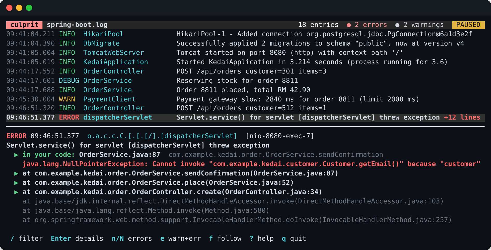

## Finding the cause

When something breaks, the first error you notice is rarely the one to fix. A database migration fails, the
app doesn't start, nginx can't reach it, and the log fills with 502s. culprit reads all of it and tells you
which error started it.

Press `a` in the viewer for the problems it found:

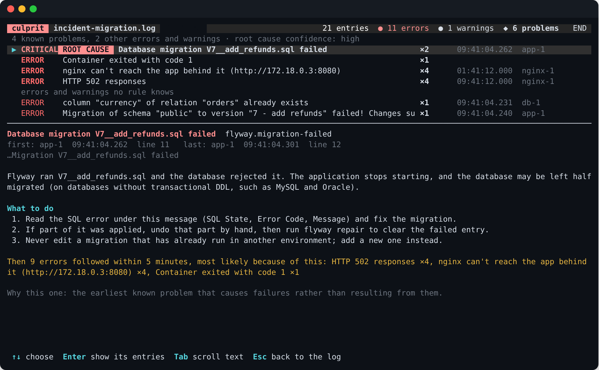

- **It recognises known problems.** Over 250 rules cover:
  - **Java and Spring:** Spring Boot, Hibernate, Flyway and Liquibase, HikariCP, the JVM, and calls between
    services (OpenFeign, RestTemplate, WebClient, Resilience4j, Eureka, Spring Cloud Config, Spring Security
    and JWTs).
  - **Databases:** Oracle (ORA- errors), PostgreSQL, MySQL, SQL Server, MongoDB and Elasticsearch.
  - **Messaging, caches and calls:** Kafka, RabbitMQ, Redis, gRPC, and SMTP for email.
  - **Cloud and payments:** AWS, Google Cloud and Azure credentials and limits, and Stripe.
  - **Other languages:** .NET and Entity Framework Core, PHP and Laravel, Ruby on Rails, Node, Python and Go.
  - **Where it runs:** Docker and Compose, Kubernetes (scheduling, volumes, RBAC), systemd, cron, nginx,
    Envoy and HAProxy, Terraform, Helm and Ansible.
  - **Builds and CI:** Maven, Gradle, npm, TypeScript, pip, Go, Docker builds and GitHub Actions, so
    `culprit analyze` on a failed CI log points at the step that broke.

  Each says what the problem means and what to do, with the values from your log filled in: the port, the
  pool, the table, the migration. The full list is in [What culprit supports](#what-culprit-supports).
- **It finds the likely root cause.** The earliest problem that *causes* failures, not the connection refused,
  timeouts and 502s that follow it, and how many errors came after it.
- **It groups the errors no rule knows.** The same error with a different order id or UUID is counted once, with
  its root exception (the last `Caused by:`) and the first line in your code.

`Enter` on a problem shows its entries in the log, with the explanation under each one. Entries with a problem
are marked `◆`, and `p` jumps to the next one.

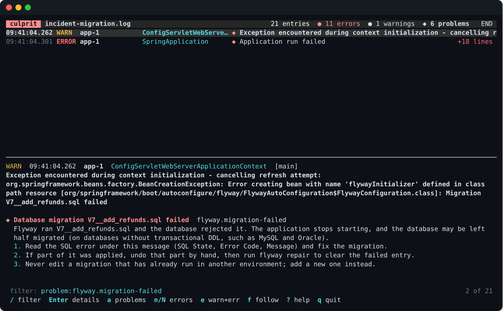

### culprit analyze

The same analysis as a report, for when you don't need the viewer: in a terminal, a pull request, or CI.

```bash
culprit analyze app.log
docker compose logs --no-color | culprit analyze
kubectl logs deploy/api --previous | culprit analyze --format markdown
culprit analyze --format json app.log | jq '.root_cause'
```

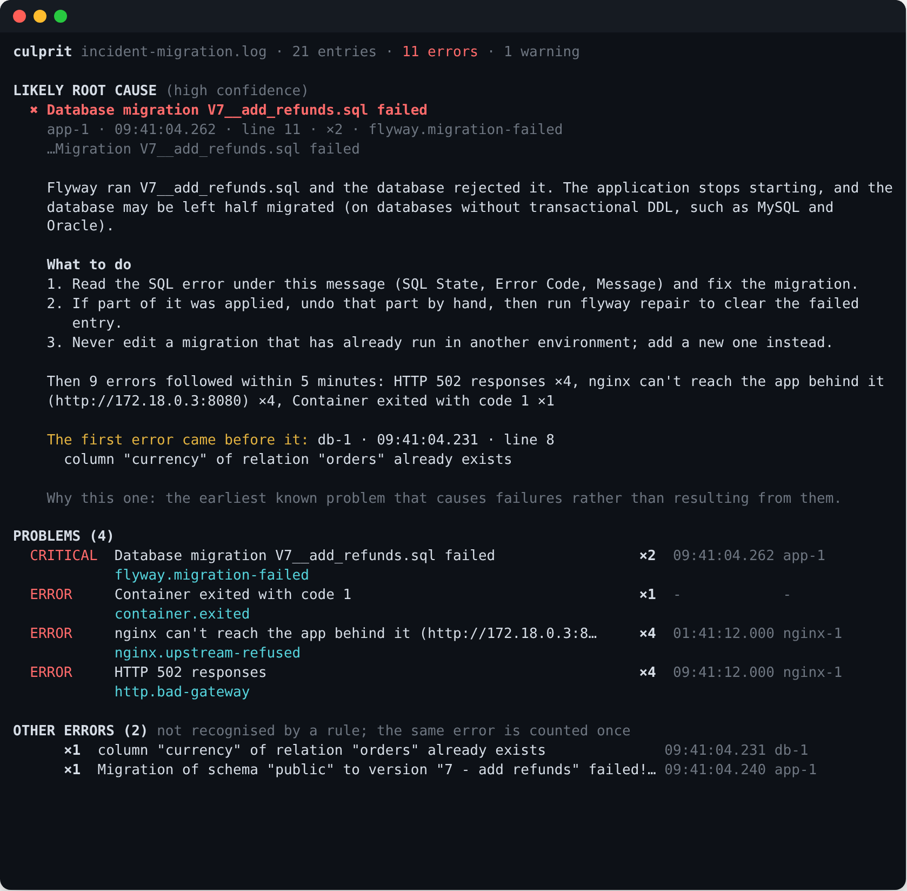

In CI, `--fail-on error` makes the step fail when the logs contain an error, and the Markdown report fits in a
job summary or a pull request comment:

```yaml
- name: What went wrong
  if: failure()
  run: |
    npm install -g culprit-cli
    docker compose logs --no-color > compose.log
    culprit analyze --format markdown compose.log >> "$GITHUB_STEP_SUMMARY"
```

### Your own rules

Add rules for the problems your team keeps meeting in `.culprit/rules/*.toml`, next to your code:

```toml
[[rule]]
id = "kedai.payment-declined"
title = "Payment declined by the bank: {reason}"
severity = "warning"
contains = ["payment declined"]
regex = 'payment declined: (\w+)'
captures = ["reason"]
explain = "The bank refused the card ({reason}). Nothing failed in our code."
fix = ["Nothing to fix; the customer has to use another card."]
examples = ['2026-10-28 10:00:00.000  WARN 1 --- [main] c.e.k.PaymentClient : payment declined: insufficient_funds']
```

`culprit rules --check` makes sure each rule recognises its examples. A rule with the id of one of culprit's
replaces it, so you can point an explanation at your own runbook. See [Writing rules](docs/rules.md).

## Asking an AI (optional)

Rules explain known problems. For the rest, or to find *where in your code* it went wrong, culprit can hand
the error to an AI and let it read your project: the code at the stack trace, a search for where a value
comes from, the recent git changes to those files. It answers with the cause, the fix, and quotes from your
files, and culprit checks every quote against the real file (`✓` or `✗`) before showing it.

```bash
culprit ai setup                   # once: choose the AI
culprit investigate app.log        # investigate the likely root cause
```

In the viewer, select an error and press `i`.

You choose the AI, and nothing is used until you do:

- **A model on your computer with [Ollama](https://ollama.com)** (free, private; `qwen3:8b` runs on an 8 GB GPU)
- **A free cloud service:** Groq, OpenRouter, Cerebras, Google Gemini
- **Your own API key:** Anthropic (Claude), OpenAI, Mistral, DeepSeek
- **Your company's server:** any OpenAI-compatible URL
- **None**

The AI can only read, only inside the project, and never files that may hold secrets (`.env`, keys,
credentials, anything git ignores). Values like passwords are redacted in what it does read. Before anything
is sent to a provider that isn't on your computer, culprit asks. It can be switched off per run (`--no-ai`),
per machine (`CULPRIT_AI=off`), or for a whole project (`ai = false` in `.culprit/config.toml`).
See [Investigating with AI](docs/ai.md).

## In your browser

`culprit web` puts everything above in a browser tab: the log, following live, with the analysis beside it
and the AI investigation a click away.

```bash
culprit web app.log
docker compose logs -f | culprit web
kubectl logs -f deploy/api | culprit web --filter "level>=warn"
```

It prints an address and opens your browser. Press Ctrl+C in the terminal to stop it.

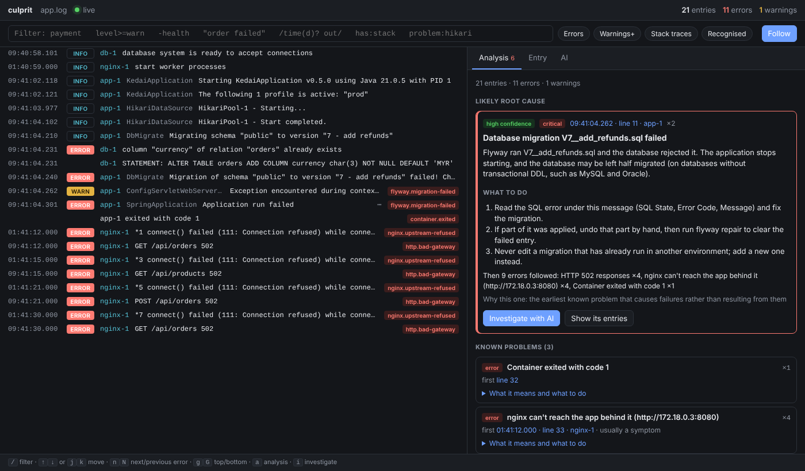

It's for longer investigations, for wide logs that don't fit a terminal, and for showing someone what went
wrong. culprit itself is still the only thing you run: the page is built into it, and nothing else is
installed or downloaded.

### What went wrong

The **Analysis** tab is `culprit analyze`, kept up to date as lines arrive: the likely root cause with how
sure culprit is and why, what to do about it, and the errors that followed from it; then every known problem
and every repeated error no rule knows. Click a time to jump to that entry, or **Show its entries** to filter
the log down to it.

### Every entry in full

Click a line to open it: its fields, the stack trace with the frames in **your** code picked out, and, when
a rule recognises it, what it means and what to do. **All like this** shows every entry with the same
problem; **Same error elsewhere** shows the repeats of an error no rule knows.

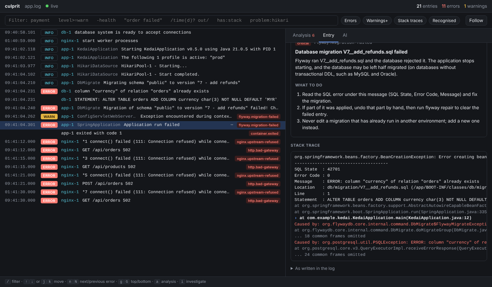

### Filtering

The filter box takes the same language as the terminal viewer ([Filters](#filters)), and what it matches is
highlighted. The buttons beside it add the common ones: errors only, warnings and up, entries with a stack
trace, and entries a rule recognised. A typo in a regular expression shows what's wrong and keeps the last
results on screen.

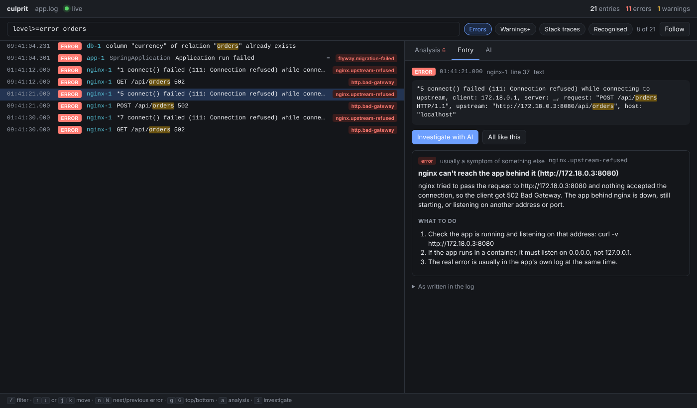

### Asking the AI

**Investigate with AI** is on the root cause, on every problem and error group, and on any entry you open.
The steps appear as the AI works (which files it reads, what it searches for), and the finding shows the
cause, what to do, and each quote from your files marked `✓` or `✗` after culprit has checked it.

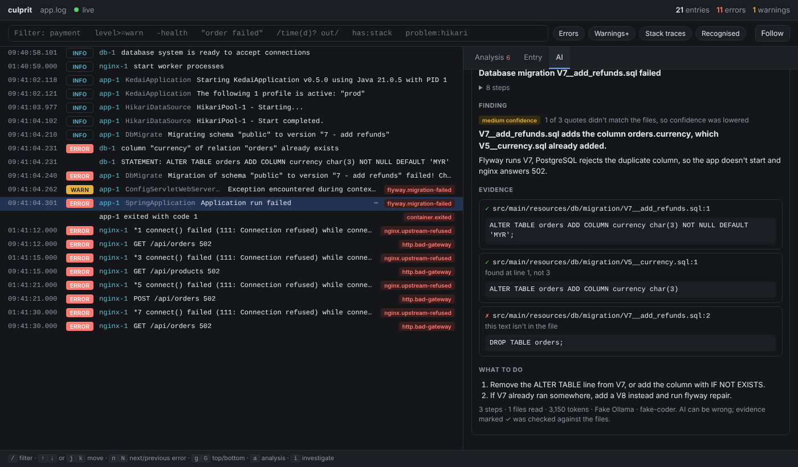

If the AI isn't on your computer, the page says exactly what would be sent, and to whom, before anything
leaves it, as the terminal does.

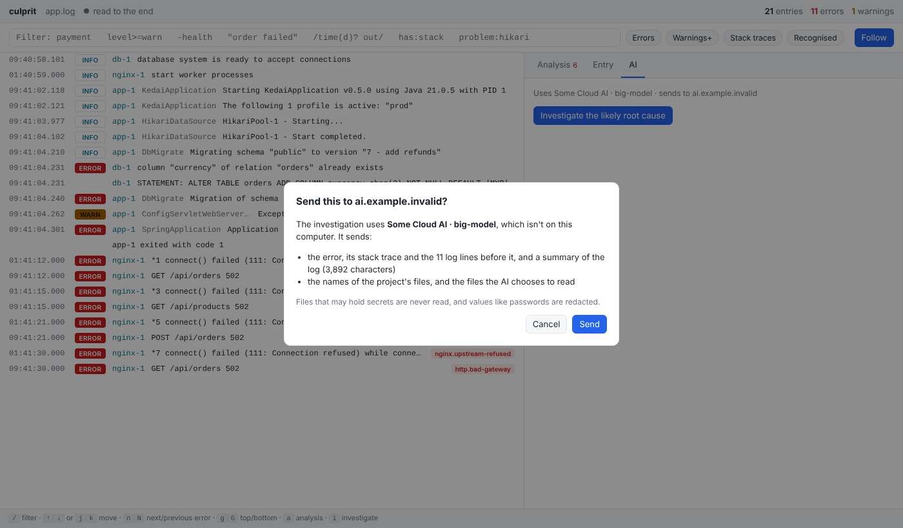

### In a narrow window

In a narrow window or on a small screen, the log and the panel stack.

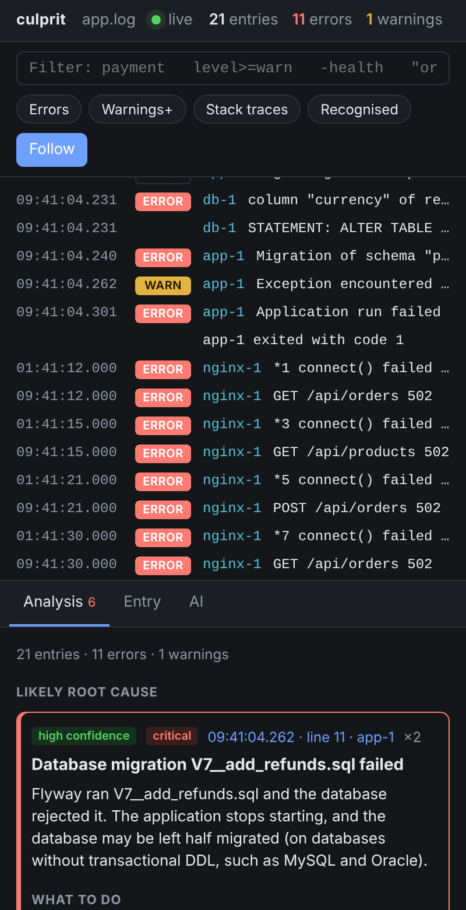

### Logs on a server

Run culprit on the server with `--no-open`, forward the port to your computer over SSH, and open the address
it printed on your own computer. Keep the port number the same on both ends, because culprit checks it:

```bash
ssh -L 4790:127.0.0.1:4790 you@server
culprit web --no-open /var/log/app.log      # on the server
```

### Keys in the page

| Key | |
|---|---|
| `/` | Filter |
| `↑` `↓` or `j` `k` | Move through the entries |
| `n` `N` | Next or previous error |
| `g` `G` | First or last entry (`G` follows new lines again) |
| `a` | The analysis |
| `i` | Investigate the selected entry with AI |
| `Esc` | In the filter box: clear it |

### Private to your computer

Logs hold secrets, and any website open in your browser can send requests to `localhost`. So:

- The server listens only on `127.0.0.1`, never on your network.
- The address carries a random 128-bit key. Without it the server answers nothing, not even the page, so
  other websites and other users on your computer can't read your logs through it. Don't share the address.
- Requests naming another host are refused, which stops a malicious site from posing as this one (DNS
  rebinding).
- Starting an investigation needs the key in a header that a page on another site can't send.
- Log text goes on the page as text, never as HTML, so a log line can't run code in it.

## What it does

- **Understands your logs without setup.** JSON from Spring Boot (ECS, Logstash, GELF), pino, zap, slog and
  python-json-logger; logfmt; Spring Boot's and logback's default patterns; Python logging and uvicorn; Go's
  `log`; nginx and Apache access logs (the HTTP status becomes the level); and the prefixes
  `docker compose logs` and `kubectl logs --prefix` add.
- **Keeps errors in one piece.** Java stack traces (with `Caused by:`), Python tracebacks and Go panics are
  attached to the line before them, so one error is one entry.
- **Points at your code.** The first frame that's yours, not Spring's, Express's or the JDK's, is shown at the
  top: `▶ in your code: OrderService.java:87`.
- **Follows live.** Files are followed like `tail -F`, including when log rotation replaces them. Piped input
  streams in as it arrives, and the keyboard still works.
- **Filters as you type.** Words, phrases, levels, fields and regular expressions, all at once.
- **Lines up services.** Several files or Compose services get a source column, and timestamps from different
  time zones are all shown in your local time.
- **Explains what went wrong.** Recognises over 250 known problems, finds the likely root cause, and groups
  repeated errors. See [Finding the cause](#finding-the-cause).
- **Copes with big logs.** A million lines (118 MB) open in a couple of seconds, and filtering them while you
  type stays instant.
- **Works in scripts too.** `--plain` prints formatted entries instead of opening the viewer. It's automatic
  when the output isn't a terminal, so `culprit --filter has:stack app.log > errors.txt` works in CI.

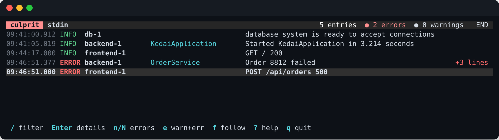

## What culprit supports

### Logs it reads

| Format | Examples |
|---|---|
| JSON, one object per line | Spring Boot structured logging (ECS, Logstash, GELF), pino, bunyan, zap, slog, python-json-logger, Docker's json-file wrapper |
| logfmt (`key=value`) | Go slog text, logrus, Heroku-style logs |
| Text patterns | Spring Boot's and logback's defaults, log4j, java.util.logging, Python logging and uvicorn, Go's `log`, PostgreSQL's server log, nginx error logs, anything with a level word up front |
| Access logs | nginx and Apache; the HTTP status becomes the level (5xx are errors, 4xx warnings) |
| Prefixes | `docker compose logs` (`api-1  \| `) and `kubectl logs --prefix` (`[pod/api/c] `) become the entry's source |

Terminal colours and other escape codes in a log are removed, so coloured output is understood too.

**From:** one or more files (followed like `tail -F`, through log rotation), or anything piped in
(`docker compose logs -f`, `kubectl logs -f`, a CI job's output).

**Stack traces:** Java and Kotlin (with `Caused by:`), Python tracebacks, Node stack traces and Go panics are kept with
the line they belong to, split into frames, and the first frame in your own code is pointed out. Other
languages' traces stay attached to their entry as text.

### Problems it recognises

257 built-in rules. Each explains the problem with the values from your log filled in, and says what to do.
List them with `culprit rules`, or [write your own](docs/rules.md). Is a common error missing? Open a
[rule request](https://github.com/amirizalrahmat0799/culprit/issues/new?template=rule-request.yml) with the log
lines.

| Area | Rules | Covers |
|---|---:|---|
| Java and Spring | 32 | Spring Boot startup (port in use, missing bean, circular dependency, datasource URL), HikariCP pool exhausted, Hibernate and JPA (including optimistic locking), transaction timeouts, unreadable request bodies, Flyway and Liquibase migrations, JVM out of memory and stack overflow, Jackson, class version and SSL trust errors |
| Spring between services | 16 | OpenFeign, RestTemplate/RestClient and WebClient failures, Resilience4j circuit breaker and bulkhead, service discovery and Eureka, Spring Cloud Config, Spring Security access denied, expired or badly signed JWTs, upload limits, full thread pools, failed health checks |
| PostgreSQL, MySQL, SQLite | 21 | Too many connections, missing table, column or database, login and permission errors (including MySQL 8's "Public Key Retrieval is not allowed"), deadlocks, lock and statement timeouts, unique violations, a full disk |
| Oracle | 14 | ORA- errors: unique constraint, missing table, invalid login, locked account, listener and service name, connect timeout, mutating table, deadlock, snapshot too old, max processes |
| SQL Server | 6 | Deadlock victim, login failed (18456), timeouts, unreachable server, invalid object name, duplicate keys |
| MongoDB | 4 | Duplicate key (E11000), server selection timeout, authentication, missing roles |
| Elasticsearch | 4 | Disk flood stage (read-only indices), circuit breaker, mapping conflicts, all shards failed |
| Kafka | 6 | Broker unreachable, missing topic, commit failed after a rebalance, offset out of range, record too large, unreadable records |
| RabbitMQ | 4 | Connection refused, login refused, queue declared with other settings, missing queue or exchange |
| Redis | 6 | Unreachable, out of memory (maxmemory), writing to a replica, cluster redirects, still loading, authentication |
| .NET | 10 | Dependency injection, scoped service in a singleton, NullReferenceException, Kestrel port in use, EF Core pending changes and concurrency, HttpClient timeouts, missing connection string or assembly, out of memory |
| PHP and Laravel | 10 | Memory and time limits, calls on null, missing classes, PHP-FPM out of workers, database connection, APP_KEY, storage permissions, missing controllers, CSRF |
| Ruby on Rails | 7 | Pending migrations, connection pool timeouts, missing database, secret_key_base, undefined method for nil, authenticity token, record not found |
| Node | 15 | Port in use, connection refused and reset, DNS, timeouts, unhandled rejections, missing modules, heap out of memory, undefined properties, too many open files, Prisma (unreachable database, unique constraints, missing records), Sequelize and TypeORM connections |
| Python | 13 | Missing modules and imports, None attributes, KeyError, recursion, ASGI app not found, port in use, Django missing tables and disallowed hosts, SQLAlchemy operational errors, gunicorn worker timeouts, Celery broker and time limits |
| Go | 6 | Nil pointer, deadlock, concurrent map writes, index out of range, context deadline exceeded, DNS |
| Containers and Kubernetes | 11 | OOMKilled, exit codes, CrashLoopBackOff, image pull errors, failed probes, eviction, missing ConfigMaps and Secrets, unschedulable pods, unbound volumes, mount failures, RBAC forbidden |
| Docker, systemd, cron | 7 | `exec format error` (an image for another CPU), ports already allocated, the Docker daemon, unhealthy Compose dependencies, failed services and restart limits, failed cron jobs |
| gRPC | 3 | Unavailable, deadline exceeded, method not implemented |
| Cloud credentials and limits | 6 | AWS (no credentials, expired token, access denied, throttling), Google Cloud and Azure credentials not found |
| Network, TLS, the machine | 13 | Connection refused, timeouts, DNS, address in use, untrusted or expired certificates, TLS handshake and version failures, certificates for another hostname, permission denied, a full disk, too many open files, the OOM killer, clocks out of sync |
| Proxies and HTTP | 11 | nginx (upstream refused, timed out or closed early, no live upstreams, body too large, response headers too big, out of worker connections), Envoy and Istio with no healthy upstream, HAProxy with no server available, 502s and 5xx responses |
| Email | 2 | SMTP login refused, mail server unreachable |
| Payments | 5 | Stripe: declined cards, webhook signatures that don't verify, reused idempotency keys, rate limits, invalid API keys |
| Terraform, Helm, Ansible | 3 | Terraform state locked, a Helm release stuck in another operation, Ansible hosts unreachable |
| Builds and CI | 19 | Maven and Gradle dependencies, compile errors and test failures, JDK too old, npm ERESOLVE, lock file out of sync and missing packages, TypeScript errors, pip, Go modules and compile errors, Docker build steps and missing files, GitHub Actions failures and timeouts |
| Harmless lines | 3 | Clients that hung up (`Broken pipe`, `ClientAbortException`), missing favicons and other static files, telemetry that couldn't be exported. Labelled harmless: listed last, never the root cause, and not counted as errors |

### AI providers (optional)

| | |
|---|---|
| On your computer | [Ollama](https://ollama.com) with any model it runs; nothing leaves the machine |
| Free cloud tiers | Groq, OpenRouter, Cerebras, Google Gemini |
| Your own API key | Anthropic (Claude), OpenAI, Mistral, DeepSeek |
| Your company's server | Any OpenAI-compatible URL |

See [Investigating with AI](docs/ai.md).

### Ways to use it

| | |
|---|---|
| `culprit app.log` | The terminal viewer: follow, filter, open entries, the problems panel, AI with `i` |
| `culprit --plain app.log` | Formatted text, for scripts and CI (automatic when the output isn't a terminal) |
| `culprit analyze app.log` | A report: text, Markdown for a pull request, or JSON; `--fail-on error` fails a CI step |
| `culprit investigate app.log` | An AI investigation of the likely root cause, in the terminal |
| `culprit web app.log` | Everything in a browser tab, live, on 127.0.0.1 only |

**Runs on:** Windows (x64), macOS (Apple Silicon and Intel) and Linux (x64 and arm64), as one program with
nothing else to install.

## Install

**npm** ([culprit-cli](https://www.npmjs.com/package/culprit-cli), for Windows, macOS, and Linux x64 and arm64):

```bash
npm install -g culprit-cli
# or try it without installing
npx culprit-cli app.log
```

npm installs only the prebuilt binary for your machine. culprit itself doesn't need Node; Node just starts it.

**Homebrew** (macOS, Linux):

```bash
brew install amirizalrahmat0799/tap/culprit
```

**Download:** take the build for your system from [Releases](https://github.com/amirizalrahmat0799/culprit/releases)
and put `culprit` on your `PATH`.

To build it yourself you need a C++20 compiler and CMake 3.24 or newer. [FTXUI](https://github.com/ArthurSonzogni/FTXUI),
the terminal UI library, is downloaded during configure unless it's already installed.

```bash
cmake -S . -B build -DCMAKE_BUILD_TYPE=Release
cmake --build build --config Release
```

## Keys

| Keys | |
|---|---|
| `↑` `↓` / `j` `k`, `PgUp` `PgDn`, `g` `G`, mouse wheel | move |
| `Enter` | open or close the details of an entry; `Tab` scrolls them |
| `a` | the problems culprit found, and the likely root cause; `Enter` shows a problem's entries |
| `p` / `P` | next / previous entry with a problem (marked `◆`) |
| `i` | ask the AI to investigate the selected error (after `culprit ai setup`) |
| `n` / `N` | next / previous error |
| `w` / `W` | next / previous warning |
| `/` | filter (`Enter` keeps it, `Esc` cancels) |
| `e` | only warnings and errors, and back |
| `x` | clear the filter |
| `f` | follow new lines on or off (`G` jumps to the end and follows) |
| `?` | all the keys |
| `q` | quit |

## Filters

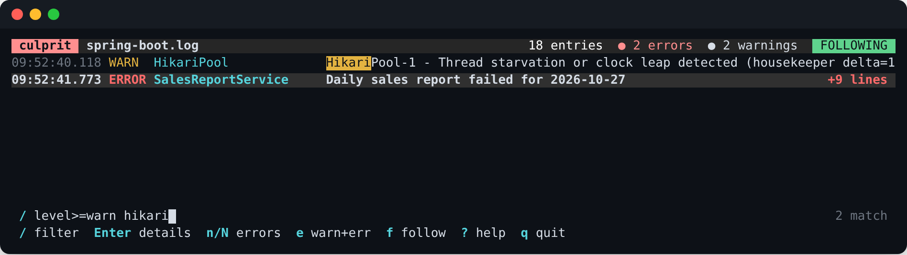

| Filter | Matches |
|---|---|
| `payment` | the word anywhere: message, logger, stack trace, fields (case doesn't matter) |
| `"order failed"` | a phrase |
| `-health` | entries *without* the word |
| `level>=warn` | warnings and worse; also `level=error`, `level<=info` |
| `logger=OrderService` | a part: `logger`, `thread`, `source`, `message`, or any field (`orderId=8812`) |
| `userId!=42` | the field doesn't contain it |
| `/time(d)? out/` | a regular expression |
| `has:stack` | entries with a stack trace |
| `has:problem` | entries a rule recognised |
| `problem:hikari` | entries recognised by a rule whose id starts with `hikari` |
| `group:3` | the unrecognised errors in group 3 (the Problems panel sets this for you) |

Terms are combined: `level>=warn payment -health` means warnings and errors about payments, without health checks.

## Options

```
culprit [options] [file...]
  -F, --filter <query>   start with a filter
  -n, --no-follow        read files to the end and stop watching them
  -p, --plain            print instead of opening the viewer
      --no-stack         with --plain: leave out stack traces
      --no-color         no colours (also when NO_COLOR is set)
      --rules <path>     more rules: a .toml file or a folder of them

culprit analyze [options] [file...]
      --format <f>       text, markdown or json
      --fail-on <s>      exit with 1 on a problem at least this severe: critical, error, warning (default: never);
                         a file that can't be read exits with 2
  -F, --filter <query>   analyse only matching entries, e.g. "source=api"
      --top <n>          how many groups of unrecognised errors to list
      --rules <path>     more rules

culprit rules [--check] [id...]

culprit investigate [options] [file...]
      --line <n>         investigate the entry at this line (default: the likely root cause)
      --problem <id>     ... or the first entry of this problem
      --format <f>       text, markdown or json
      --yes              don't ask before sending to a provider that isn't on this computer
      --show-prompt      print what would be sent, and stop
      --project <dir>    the project to read (default: the git repository you're in)

culprit web [options] [file...]
  -F, --filter <query>   start with a filter
  -n, --no-follow        read files to the end and stop watching them
      --port <n>         the port to try first (default 4790; the next free one is used)
      --no-open          print the address instead of opening the browser
      --rules <path>     more rules
      --no-ai            don't offer AI investigation

culprit ai setup | status | on | off
```

## How it's built

```
src/core/      no terminal code; tested on its own
  parser       recognises each format, strips Compose/kubectl prefixes, joins stack traces
  json         a small JSON reader that flattens objects into dotted keys (log.level, error.stack_trace)
  time         ISO 8601, Python/Log4j, bare clocks, epoch numbers; zoned times shown in local time
  stack        splits Java, Python, Node and Go traces into frames and tells your code from libraries
  filter       the filter language
  reader       background threads that follow files and stdin, and hand over entries in batches
  model        entries, the filter, the visible rows and counts per level
  rules        rule files: loading, checking, and matching every rule in one pass over each entry
  toml         a small reader for the part of TOML rule files use
  analyzer     problems, groups of repeated errors, and the likely root cause, kept up to date as lines arrive
src/ai/        the investigator: providers (OpenAI-compatible and Anthropic), the read-only project tools and
               their safety checks, the step loop, and checking the evidence
src/tui/       the FTXUI viewer, the plain printer and the analyze report
src/web/       culprit web: a small server on 127.0.0.1 with a JSON API, and the page (one HTML file,
               compiled into the program)
rules/         culprit's own rules, compiled into the program
```

- **Parsing is hand-written, not regular expressions.** It's both faster and more forgiving of the many small
  variations real logs have.
- **Reading never blocks the screen.** Background threads parse, and the viewer takes finished entries in
  batches. Only the rows on screen are drawn, so the size of the log doesn't matter.
- **A new entry is held back for a moment,** because the next lines might be its stack trace.
- **Rules are matched in one pass.** The text every rule looks for goes into one
  [Aho-Corasick](https://en.wikipedia.org/wiki/Aho%E2%80%93Corasick_algorithm) automaton, so an entry is read
  once however many rules there are; a rule's regular expression only runs on the lines that contain its text.
- **The root cause is a judgement, and says so.** It's the earliest problem that causes failures rather than
  resulting from them, with high, medium or low confidence. Times are compared across services only when the log
  says which time zone it uses; otherwise the order the lines arrived in decides.
- **Every rule carries a real log line as an example,** and the tests check each rule recognises its own.
- **To talk to an AI, culprit uses the system's HTTP client:** libcurl on Linux and macOS (loaded only when
  the AI is used) and WinHTTP on Windows, so it follows the system's proxy and certificate settings.
- **The web viewer's server is [cpp-httplib](https://github.com/yhirose/cpp-httplib),** one header,
  downloaded by the build and pinned by its SHA-256. The page is plain HTML and JavaScript with no framework,
  and it puts log text on the page only as text, never as HTML, so a log line can't run code in it.
- **The browser asks for what it shows.** The server holds the entries; the page asks which ones match the
  filter and fetches only the rows in view, so a log of hundreds of thousands of lines scrolls as smoothly as a short one.
  It learns about new lines with a long poll: a request that waits until something changes.
- **The AI's safety rules are enforced by culprit, not asked of the model.** Every path it requests is
  resolved and checked before anything is read, and its answer is checked against the files after.
- **Piped input and the keyboard both work:** culprit keeps a copy of the pipe and points stdin back at the
  terminal (`/dev/tty`, or `CONIN$` on Windows).

## Tests

```bash
ctest --test-dir build --output-on-failure
```

The sample logs in [`testdata/`](testdata) cover every supported format, plus two incidents (a failed
migration that takes down an app behind nginx, and Redis running out of memory under a checkout flow), and [`testdata/kedai`](testdata/kedai) is the small project behind it.
The web tests start the server and check that it answers nothing without its key or for another host,
and what each API returns. The AI tests use a scripted model, and `tests/ai_e2e.sh` runs whole investigations over HTTP against a fake
provider in both API formats, checking that secrets and files outside the project are never sent. The tests check what each one parses into (levels, loggers, threads,
messages, fields, stack traces kept whole, the first frame in your code) and what the analysis finds. Every
built-in rule is checked against its examples. CI builds and tests on Windows, Linux and macOS.

## Roadmap

culprit was built in five steps:

1. **The viewer** (0.1): reading, following, filtering, and pointing at your code.
2. **The analyser** (0.2): rules that recognise common problems and say what to do, groups of repeated
   errors, and the *first* failure behind a cascade of follow-on errors.
3. **The investigator** (0.3): an AI of your choice (Ollama on your computer, a free cloud
   service, or your own API key) reads your project, read-only, and explains the root cause with evidence
   that culprit checks against your files.
4. **The web viewer** (0.4): all of it in a browser tab, live, on your own computer.
5. **More rules** (0.5, this release): over 250, adding messaging and caches, calls between services, gRPC,
   more databases, cloud credentials, payments, .NET, PHP, Rails, deployment and build logs, and labels for the
   harmless lines that look like errors.

## License

[MIT](LICENSE) © Ahmad Amirizal Rahmat
