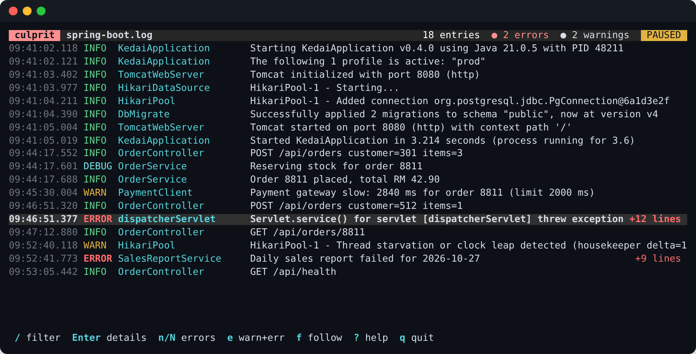

# culprit

**Read your logs in the terminal, follow them live, and get to the line in your code that failed.**

```bash
npm install -g culprit-cli

culprit app.log
docker compose logs -f | culprit
kubectl logs -f deploy/api | culprit
culprit analyze app.log          # the likely root cause, and what to do
culprit investigate app.log      # optional: an AI of your choice finds the cause in your code
culprit web app.log              # all of it in your browser, live, on 127.0.0.1 only
```

Or without installing: `npx culprit-cli app.log`



culprit understands JSON logs (Spring Boot, pino, zap, slog, python-json-logger), logfmt, Spring Boot and
logback's default patterns, Python, Go, PostgreSQL, and nginx and Apache access logs. It keeps Java, Python and
Go stack traces in one piece and shows the first frame that's in **your** code. Over 250 rules recognise known
problems (Spring Boot and calls between services, Hibernate, Flyway, HikariCP, Oracle, PostgreSQL, MySQL, SQL
Server, MongoDB, Elasticsearch, Kafka, RabbitMQ, Redis, gRPC, AWS, Google Cloud, Azure, Stripe, .NET, PHP and
Laravel, Rails, Node, Python, Go, Docker, Kubernetes, systemd, nginx, Envoy, HAProxy, and build and CI logs), explain them, and point at the error that started the
cascade.

This package is a small launcher. npm also installs the prebuilt binary for your machine from one of these:
`culprit-cli-linux-x64`, `culprit-cli-linux-arm64`, `culprit-cli-darwin-universal`, `culprit-cli-windows-x64`.
culprit itself is written in C++ and doesn't need Node to run; Node only starts it.

Keys, filters and options: [github.com/amirizalrahmat0799/culprit](https://github.com/amirizalrahmat0799/culprit#readme)

MIT © Ahmad Amirizal Rahmat
